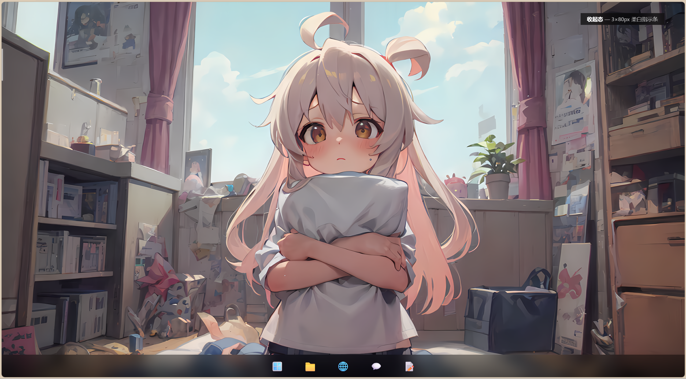
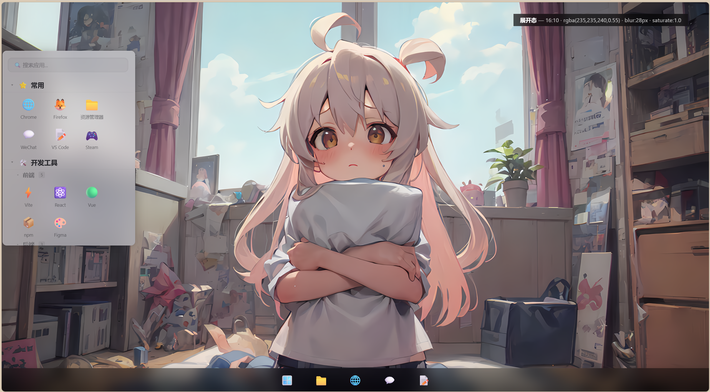
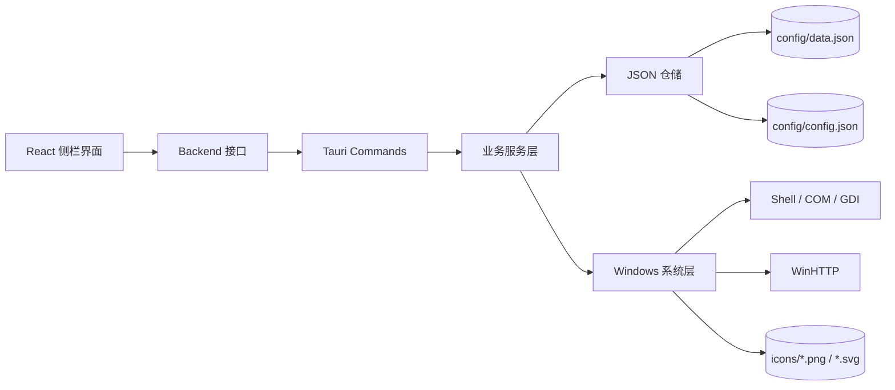

<div align="center">
  <h1>DeskCrate</h1>
  <p><strong>一个轻量、可折叠的 Windows 桌面启动器。</strong></p>
  <p>把应用、快捷方式、文件夹、文件和网址收进一条始终在手边的悬浮侧栏。</p>
  <p>
    <a href="https://github.com/tyx-git/DeskCrate"></a>
    
    
    
  </p>
</div>




## 项目简介

DeskCrate 是一个面向 Windows 的桌面启动器。它以透明、无边框的悬浮侧栏承载分类、分组和应用入口，支持从键盘、鼠标和文件拖放快速整理日常工作环境。

项目采用本地优先的设计：目录数据、窗口配置和图标缓存都保存在程序目录中，应用入口由后端生成稳定 ID，前端只通过类型化的 Tauri Command 访问业务能力。

## 功能一览

### 入口管理

- 添加和管理 Windows 快捷方式（`.lnk`）、可执行文件、文件夹、普通文件和网址。
- 创建、重命名、删除分类与分组，支持最多四层分组嵌套。
- 应用可以直接放在顶层，也可以放入分类或分组；顶层应用与分类保持原有顺序交错排列。
- 通过右键菜单完成新建、重命名、删除和启动操作。
- 搜索应用名称，支持文件拖放添加入口。
- 应用图标支持拖拽换位，落点会显示插入位置。

### 悬浮侧栏

- 透明、无边框、置顶、跳过任务栏的 Windows 悬浮窗口。
- 展开态与收起态之间平滑切换，收起后缩成窄小的指示条。
- 收起动画尊重系统 `prefers-reduced-motion` 设置。
- 展开态支持从右侧、顶部和底部调整窗口尺寸，尺寸跨重启保存。
- 窗口尺寸按 CSS 像素保存，切换显示器缩放比例后仍能保持用户设定。
- 支持自动收起与开机自启动，均可在设置页中切换。

### 图标获取

- 本地应用：通过 Windows Shell、GDI 和快捷方式信息提取系统图标。
- 网址图标：后台异步抓取，不阻塞添加操作。
- 候选来源依次包括页面中的 `<link rel="icon">`、站点约定路径和站点专属静态资源。
- 支持 PNG、JPEG、GIF、WebP、ICO 和 SVG；位图统一缓存为 PNG，SVG 保留为 SVG。
- GitHub 使用官方静态资源 `github.githubassets.com/favicons/favicon.svg`，适配 GitHub 首页或根 favicon 被网络策略拦截的情况。
- 同源网址优先复用已有图标缓存，减少重复请求并保持同站点入口的视觉一致。
- 抓取失败时使用内置地球图标，不影响网址应用添加。

## 技术架构



### 分层职责

| 层 | 目录 | 主要职责 |
|---|---|---|
| 前端 | `react/src/components` | 侧栏、设置页、菜单、对话框和交互反馈 |
| 状态 | `react/src/state` | Zustand 状态、乐观更新和前后端同步 |
| API | `react/src/api` | Tauri 后端与浏览器 mock 后端的统一接口 |
| Command | `src-tauri/src/commands` | Tauri IPC 边界、参数组装和事件派发 |
| Service | `src-tauri/src/services` | 目录树、设置、窗口、图标等业务流程 |
| Storage | `src-tauri/src/storage` | JSON 读取、校验、迁移和原子替换 |
| System | `src-tauri/src/system` | Windows Shell、COM、GDI、WinHTTP 和注册表 |
| Model | `src-tauri/src/models` | 持久化模型、请求模型和序列化契约 |

## 技术栈

| 领域 | 技术 |
|---|---|
| 桌面框架 | Tauri 2.11 |
| 后端 | Rust 2021、Serde、Chrono、UUID |
| Windows 集成 | `windows` 0.58、COM、Shell、GDI、WinHTTP |
| 前端 | React 19、TypeScript 6、Vite 8 |
| 样式 | Tailwind CSS 4、容器查询单位 `cqw` |
| 状态管理 | Zustand 5 |
| 图像处理 | `image` 0.25 |
| 数据存储 | Pretty JSON、同目录临时文件、原子替换 |

## 运行环境

- Windows 10 或 Windows 11 x64
- Rust stable，目标工具链为 `stable-x86_64-pc-windows-msvc`
- Visual Studio Build Tools，包含 MSVC 与 Windows SDK
- Node.js 20.19+、22.12+ 或 24+
- Microsoft Edge WebView2 Runtime

## 快速开始

### 获取源码

```powershell
git clone https://gitee.com/tian-someone/DeskCrate.git
Set-Location DeskCrate
```

### 安装依赖

```powershell
rustup toolchain install stable-x86_64-pc-windows-msvc
rustup override set stable-x86_64-pc-windows-msvc
npm install --prefix react
cargo install tauri-cli --version "^2.0" --locked
```

如果本机已经安装对应版本的 Tauri CLI，可以跳过最后一条命令。

### 启动完整桌面应用

```powershell
cargo tauri dev
```

Tauri 会启动 Vite 开发服务器，并在前端初始化完成后显示透明悬浮窗口。

### 构建 release

先构建前端，再构建带内嵌资源的 Rust release：

```powershell
npm --prefix react run build
Set-Location src-tauri
cargo build --release --features custom-protocol
```

最终产物：

```text
src-tauri/target/release/deskcrate.exe
```

`custom-protocol` feature 会把 `react/dist` 嵌入二进制，使程序可以脱离 Vite 开发服务器运行。

## 数据与文件布局

DeskCrate将运行时数据保存在可执行文件同级目录，便于移动和备份：

```text
deskcrate.exe
config/
  data.json       分类、分组、应用和快捷方式
  config.json     主题、窗口状态、自动收起和开机自启动
icons/
  <app-id>.png    位图图标缓存
  <app-id>.svg    SVG 图标缓存
```

`data.json` 与 `config.json` 分开保存。写入前会在内存中完成模型修改和校验，落盘时使用同目录临时文件与原子替换。启动时会对图标缓存做对账，清理严格符合应用 ID 命名规则的孤儿缓存。

开机自启动使用当前用户的 Windows 注册表项：

```text
HKCU\Software\Microsoft\Windows\CurrentVersion\Run\DeskCrate
```

## 后端 Command

前端通过 `react/src/api/backend.ts` 定义的统一接口访问后端；Tauri 环境使用真实 Command，浏览器环境使用 mock 实现。

| 接口组 | Command |
|---|---|
| 数据 | `get_all_data` |
| 分类 | `add_category`、`rename_category`、`delete_category` |
| 分组 | `add_group`、`rename_group`、`delete_group` |
| 应用 | `add_app`、`rename_app`、`delete_app`、`move_app`、`launch_icon` |
| 设置 | `get_settings`、`update_settings` |
| 窗口 | `is_init`、`apply_view_mode`、`resize_window`、`finish_window_resize` |

新增节点的 UUID 由后端生成。前端根据返回的 ID 进行重命名、删除、启动和拖拽换位，不使用名称作为主键。

## 项目目录

```text
DeskCrate/
├─ react/                    React + TypeScript 前端
│  └─ src/
│     ├─ api/                Tauri/mock 后端抽象
│     ├─ components/         侧栏、设置页、菜单和对话框
│     ├─ hooks/              自动收起、快捷键、文件拖放
│     ├─ lib/                树操作、窗口几何等纯逻辑
│     ├─ state/              Zustand stores
│     └─ types/              前端模型契约
├─ src-tauri/
│  ├─ src/
│  │  ├─ commands/           IPC 边界
│  │  ├─ services/           业务流程
│  │  ├─ storage/            JSON 仓储与原子写入
│  │  ├─ system/             Windows 系统集成
│  │  └─ models/             数据与请求模型
│  └─ tests/                 Rust 集成测试
├─ docs/assets/              README 展示截图
└─ README.md
```

## 参与开发

欢迎通过 GitHub 提交 Issue 和 Pull Request：

- Issue：<https://gitee.com/tian-someone/DeskCrate/issues>
- Pull Request：<https://gitee.com/tian-someone/DeskCrate/pulls>
- 项目地址：<https://gitee.com/tian-someone/DeskCrate.git>

提交 Issue 时请包含复现步骤、预期行为、实际行为、Windows 版本和相关日志。涉及模型、Command 或持久化格式的改动，请同时补充对应测试。

## 作者与版本

- 作者：TTxyz
- 当前版本：`v1.0.0`
- 仓库：<https://gitee/tian-someone/DeskCrate.git>

## 许可证

当前仓库尚未加入许可证文件。许可证文件加入前，项目内容默认保留所有权利。
